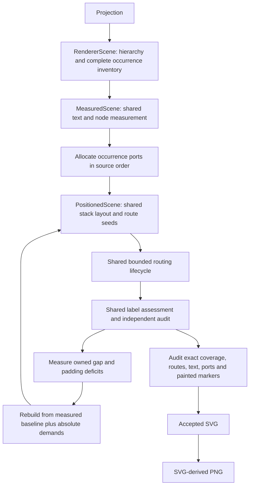

# IA Place Map

Containment owns the hierarchy and source ordering. Navigation is a separate
occurrence inventory: a selected return, cross-Area connection, or parallel
navigation never creates another Place or changes containment.

## Bundle authority and preparation

`bundle/v0.2/core/views.yaml` opts IA into exact projection references,
complete navigation occurrence coverage, event/guard presentation, and singleton
unannotated containment/navigation fusion. `core/contracts.yaml` governs supported
annotations and identifies Event references for name resolution. The real bundle
loader validates those policies before use. Capability absence retains the legacy
behavior, including the v0.1 baseline; there is no bundle-version routing branch.

`projectView` emits exact `source_edge_id` references for enabled combined and
named IA selections. Public preparation reconstructs the source occurrence index
from the supplied graph and bundle and rejects missing, stale, substituted, or
incomplete references. Projection topology is unchanged.

`buildIaPlaceMapRenderModel` prepares labels through the shared relationship
formatter. Event names are resolved without projecting Events; conflicting names
include IDs, and unresolved names retain the authored reference. Bundle templates
and detail switches control presentation. DOT, Mermaid, and staged outputs consume
the same label payload, with their own escaping and layout.

## Staged pipeline

`runIaPlaceMapRendererPipeline` supplies ownership and endpoint preferences over
shared measurement, macro layout, port capacity, route candidates, routing
lifecycle, label capacity/search, and marker geometry. It preserves the existing
containment/follower placement plan while emitting every selected navigation
occurrence independently. Fusion requires exactly one unannotated navigation and
one matching containment declaration; parallel or annotated navigation stays
separate from structure.

Capacity requests belong to an actual adjacent sibling gap or Area/root padding.
The shared `gapAfter` layout intent widens that gap only, and remeasures containers
before reflowing ancestors and later siblings. Area top padding owns header-to-first
Place channels; exterior padding owns channels outside descendant node bodies.
Container interiors remain traversable; node bodies and Area headers block routes.
No final coordinates or line breaks enter RendererScene or projection.

Port allocation tries legal alternatives with bounded side capacity and marker
terminal legs. Source order provides deterministic allocation. Route and label
passes share the existing finite expansion budget; repeated geometry states or
unresolved capacity produce diagnostics instead of speculative retries.

## Final acceptance

Only explicitly identified structural source trunk segments may share a track.
Navigation receives no whole-path sharing exemption. Independent final checks
compare the original occurrence/label/marker inventory with the emitted scene,
validate attachment sides and insets, and check route separation, body/header
collisions, label association and ambiguity, painted arrowheads, and export bounds.
The SVG backend repeats acceptance immediately before serialization. Failed enabled
IA artifacts are withheld in combined and named public paths, including `force`.
PNG rasterizes that same accepted SVG.

## Source files and evidence

- [iaPlaceMapRenderModel.ts](../../src/renderer/iaPlaceMapRenderModel.ts)
- [relationshipLabelFormatter.ts](../../src/renderer/relationshipLabelFormatter.ts)
- [iaPlaceMap.ts](../../src/renderer/staged/iaPlaceMap.ts)
- [iaPlaceMapRouting.ts](../../src/renderer/staged/iaPlaceMapRouting.ts)
- [connectorLabelLayout.ts](../../src/renderer/staged/connectorLabelLayout.ts)
- [routingCore](../../src/renderer/staged/routingCore)
- [markerAudit.ts](../../src/renderer/staged/markerAudit.ts)
- [Implementation evidence](../ia_place_map_hardening/implementation_evidence.md)
