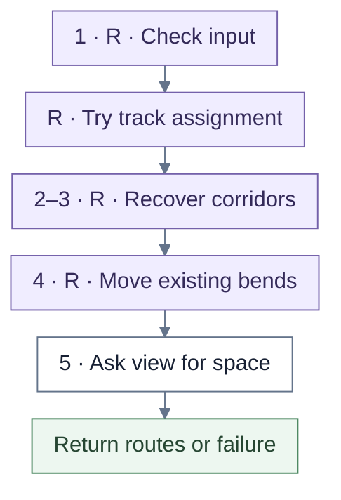
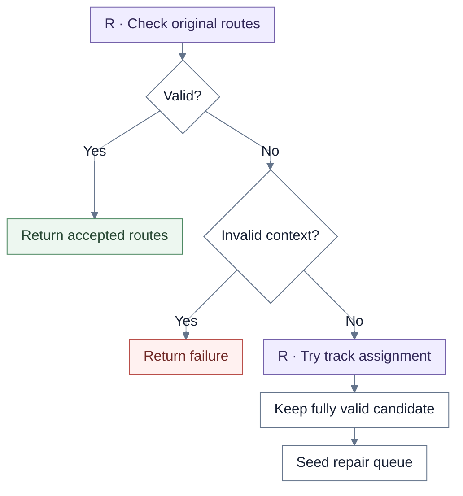
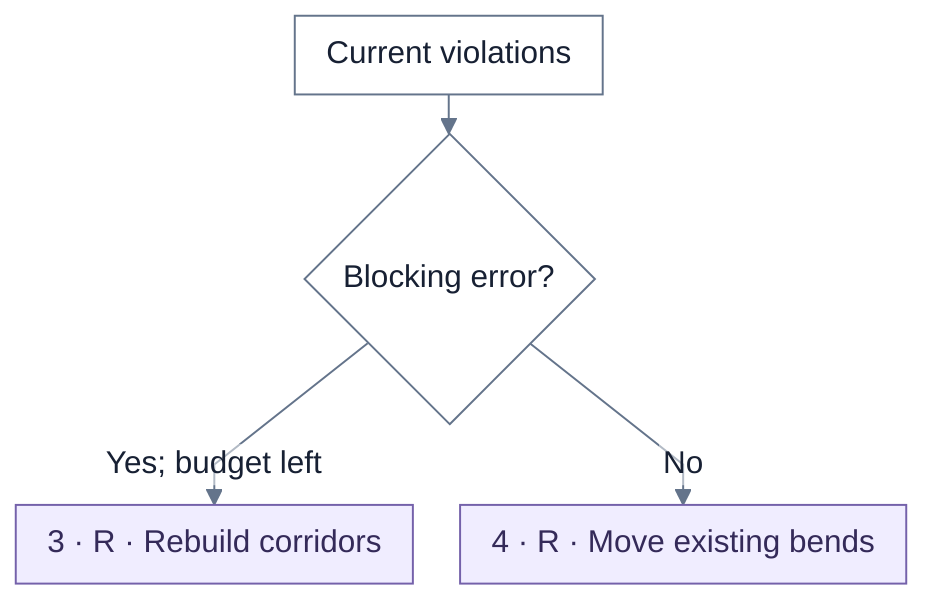
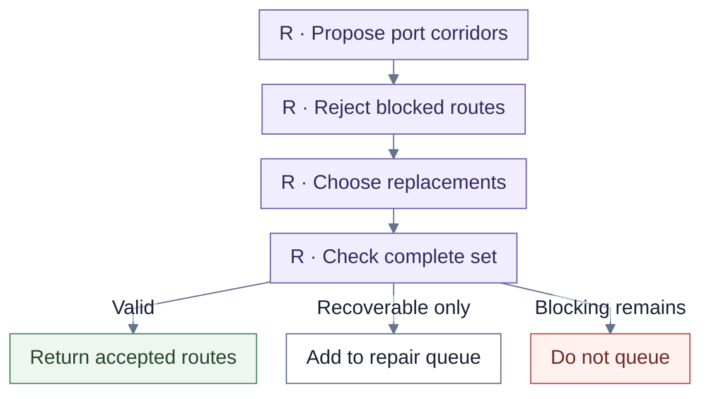
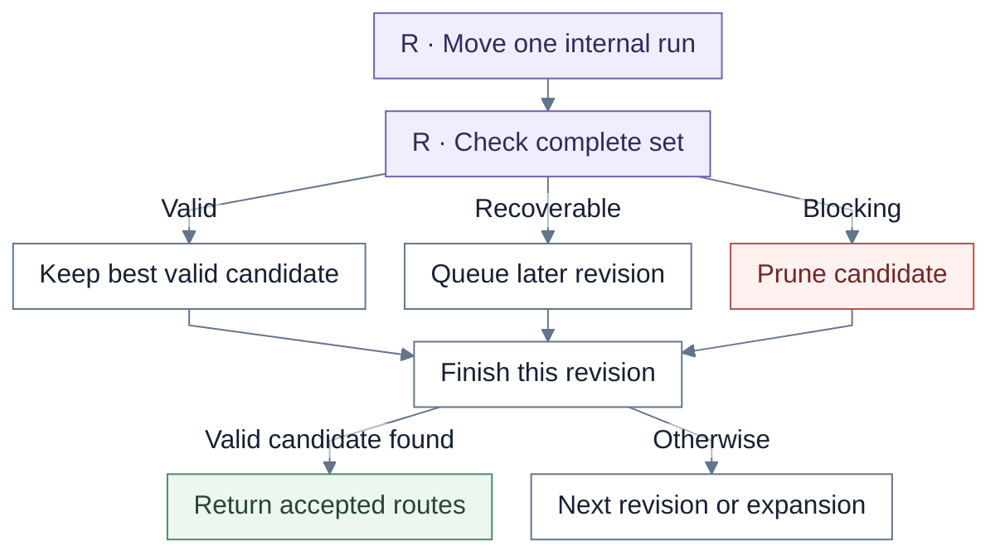
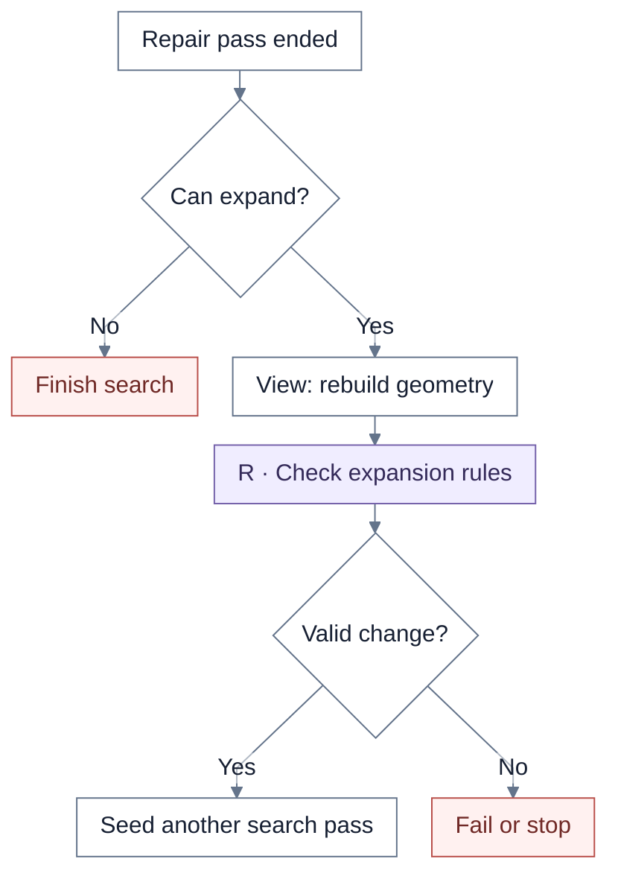
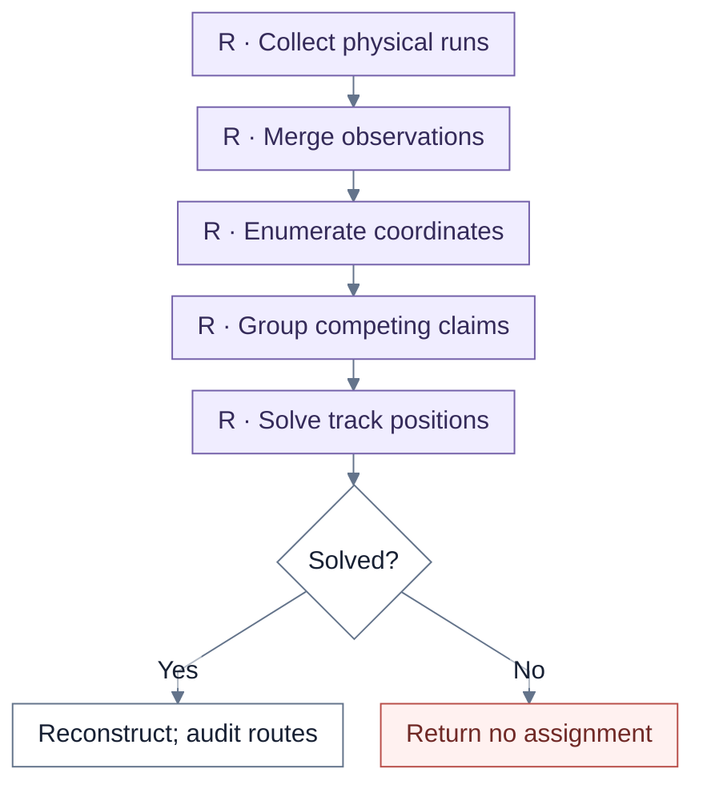
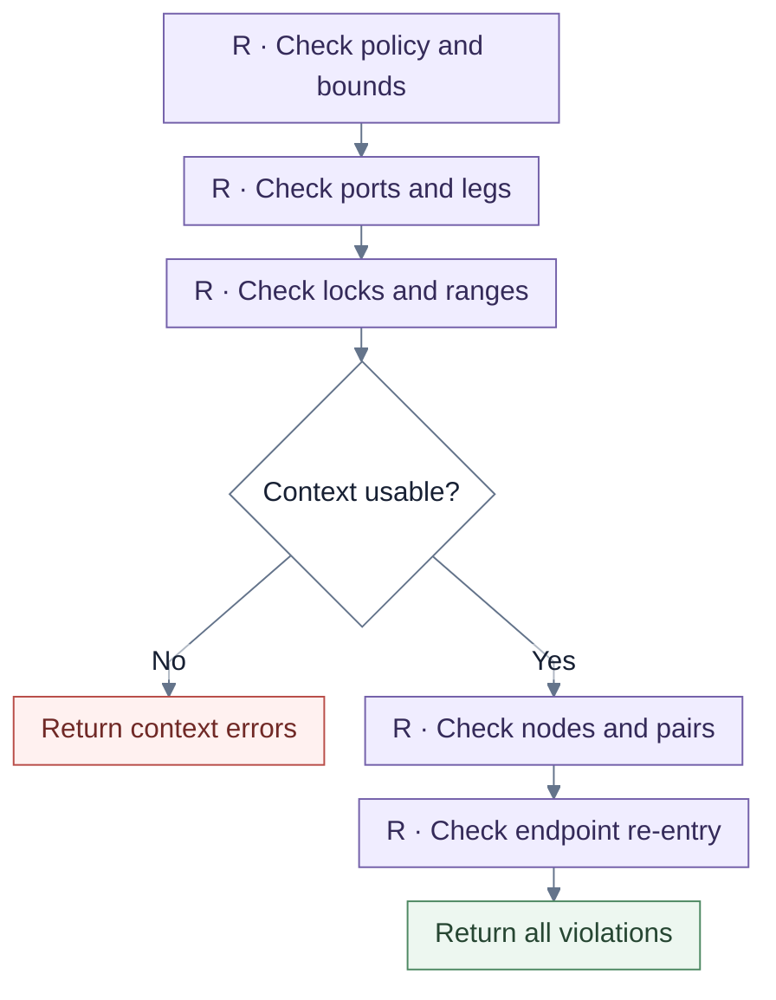

# Shared routing

**R** marks shared routing. Unmarked view callbacks own scene expansion; Journey supplies its own track adapter. Each chart shows one part of the shared search.

**S** = shared rendering. **R** = shared routing. Unmarked steps belong to the view unless a callback or caller is named.

## Overview

Valid input or a valid search candidate can return early. Track assignment is an initial candidate, not a replacement for complete-route acceptance. The lifecycle's budgets are **4,096 candidates** and **128 repair revisions**, shared across expansion passes.

| Chart step | Implementation |
| --- | --- |
| Lifecycle | `runRoutingLifecycle` |
| Track assignment | `resolveAndReconstructRouteOccupancy` |

## 1. Check and seed

Budget values must be finite safe integers. The complete validator rejects malformed contexts. An `endpoint_mismatch` causes immediate invalid-context failure. A resolved assignment is globally checked and retained only if fully legal; failed assignment still proceeds to repair.

| Chart step | Implementation |
| --- | --- |
| Input / seed | `runRoutingLifecycle`, `validateFinalRouteSet` |
| Assignment | `resolveAndReconstructRouteOccupancy` |

## 2. Corridor-recovery gate

**Overlap, track spacing, and crossings alone take the lower path.** The traversable set is exactly `collinear_overlap`, `track_separation`, and `perpendicular_crossing`. Port-corridor reconstruction is triggered only by another violation kind and remaining candidate budget. This is the branch relevant to the reported overlap failure.

| Chart step | Implementation |
| --- | --- |
| Gate | `hasBlockingViolation`, `runRoutingLifecycle` |

## 3. Rebuild corridors

Only connectors implicated in blocking kinds are considered. Candidates must stay within bounds, clear nodes/envelopes, and avoid re-entering endpoint boxes. With declared clearance envelopes, selection minimizes conflict against settled routes; otherwise it uses the first clear corridor. A new combined route set consumes candidate budget and receives full validation.

| Chart step | Implementation |
| --- | --- |
| Recovery / proposals | `buildCorridorRecovery`, `buildPortCorridorCandidates` |
| Complete check | `validateFinalRouteSet` |

## 4. Move existing bends

Each revision pops the best queued state. Repeated geometry is skipped; new candidates consume budget and are scored. Alternatives move existing internal coordinates; they **do not add bends**, though redundant points can collapse. The revision keeps the best fully valid candidate, including any retained initial assignment. Further search requires a nonempty queue and remaining budgets.

| Chart step | Implementation |
| --- | --- |
| Alternatives | `buildTerminalTurnAlternatives` |
| Check / rank / loop | `validateFinalRouteSet`, `score`, `runRoutingLifecycle` |

## 5. Ask the view to expand

Expansion requires a callback and remaining expansion, candidate, and revision budgets. It must retain IDs, endpoint sides, priorities, locks, sharing, nodes/blockers, and margins. Invalid constraints fail; unchanged geometry or shrinking bounds stops the search. Counters are not reset. On termination, a still-retained valid assignment can be returned; otherwise failure includes the best violations, debug connectors, and trace.

| Chart step | Implementation |
| --- | --- |
| Expansion / termination | `runRoutingLifecycle`, `copyForExpansion` |

## 6. Solve physical tracks

Ranges, locks, obstacle constraints, resources, and sharing are aggregated per physical run. Contradictory claims or absent candidates can return before search. Each component keeps an unchanged legal assignment or searches with a bounded best incumbent. Lifecycle occupancy and Journey use 250 states; the direct solver default is 2,000. Failure returns no partial accepted assignment.

The lifecycle wrapper reconstructs with shared code. Journey maps its own current runs/resources, calls observation aggregation and the solver directly, and reconstructs in Journey code. Both callers must audit full routes after reconstruction.

| Chart step | Implementation |
| --- | --- |
| Occupancy adapter | `resolveRouteSegmentOccupancy`, `resolvePhysicalSegmentOccupancy` |
| Claims / solver | `aggregateRoutingObservations`, `solveRoutingClaims` |
| Shared reconstruction | `reconstructRouteFromAssignments` |
| Journey reconstruction | `reconstructRouteFromResolvedRuns` |

## 7. Complete route validation

Complete checks include finite geometry, IDs/styles, outward departure, marker/stub legs, bounds, node clearance, overlaps, separation, crossings, and endpoint-box re-entry. Pairwise interactions are always enabled. Empty violations permit acceptance.

IA/UI's scene wrapper supplies routes and node boxes to the lower-level validator. It does not supply the lifecycle's full endpoint-side, marker-leg, lock, and finite-bound context. Scene sharing exemptions remain caller-specific.

| Chart step | Implementation |
| --- | --- |
| Lifecycle validation | `validateFinalRouteSet` |
| Lower-level / scene validation | `validateRouting`, `validatePositionedSceneRouting` |

## Opt-in ownership and readable geometry

`FinalRoutingConnector.routingBounds` carries a rectangle and `ownerId`. Candidate
coordinates and complete-route acceptance intersect that rectangle with the root
bounds. Ownership is independent of topology-indexed run locks: corridor repair may
replace an unconstrained topology while retaining its owner. Expansion receives a
detached copy and must retain owner identity; the adapter rebuilds the rectangle from
its reflowed owner. The generic router does not interpret container node types.
Absent connector bounds retain root-only behavior.

The shared readable geometry helpers are opt-in:

| Helper | Contract |
| --- | --- |
| `READABLE_ROUTING_GEOMETRY` | 16px readable gap; 0.5px tolerance |
| `readableRoutingClearance(strokeWidth)` | 16px plus half the nonnegative painted stroke width |
| `readablePortPitch(arrowSize, strokeWidth)` | 16px plus half the nonnegative arrow size and the nonnegative stroke width |

Nonfinite theme geometry is rejected. A larger stroke or arrow increases required
space. These helpers do not change existing validation-policy defaults.
`RoutingBox.blocksAxis` permits transverse crossings while reserving parallel
stand-off. `exemptSharedTrackGroupIds` exempts only segments declaring a matching
shared group; other segments of that connector remain checked. Expansion must retain
obstacle margins, applicability, and shared-segment exemption declarations.

`allocatePortOffsets` centres a singleton exactly and places odd/even groups
symmetrically at the requested minimum pitch. Fixed reservations can translate the
whole group to its nearest feasible position; a negative shift wins an exact tie.
The allocated result records signed `displacementFromCenter`. Request order is
preserved. `availableSlots` reports free continuous-side capacity, which can exceed
the requested count even when fragmented reservations prevent a symmetric group
from fitting. Such a case returns `capacity_exhausted`; ports are not squeezed or
split into disconnected groups. Structural exceptions remain adapter-owned.
`resolveFacingSideSharedCoordinate` finds the common legal span on either axis and
minimizes squared displacement from both centres.

`buildPortCorridorSeed` supplies a deterministic outward U for distinct orthogonal
attachments on the same side. It uses each endpoint's minimum leg and the supplied
outward clearance to choose one common exterior coordinate. It changes neither
attachment identity nor owner bounds; complete acceptance still rejects a seed
outside owned space. Straight intent, differing sides and coincident cross-axis
attachments are not rebuilt. Adapters account for this seed trial before using it
for routing or label-capacity assessment.

`measureExteriorRoutingCorridorDeficit` measures owned exterior capacity by span
intervals on any side. Its events are owner, box, and physical-track claim boundaries;
each interval uses only overlapping tracks and its nearest content wall. Required
space is `2 * clearance + (activeTracks - 1) * separation`; the result is the largest
positive deficit. Disjoint spans reuse slots. Each claim denotes one physical track;
adapters normalize shared observations before calling. This avoids combining a
shallow node in one row with track counts from another row.

## Opt-in complete-scene quality selection

`runRoutingLifecycle` continues to preserve valid input and repair invalid input.
Quality optimization is a separate service; enabling it does not change that
compatibility contract.

`routingEndpointEnvelopeExhausted` certifies that a turned endpoint cannot fit its
minimum leg or painted clearance inside its effective owner bounds. A legal
incident-only direct attachment remains exempt. An adapter may retain that seed
for measured capacity while skipping futile proposal enumeration.

`generateRoutingQualityCandidates` preserves caller-fixed connectors and declared
run/shared resources. It considers aligned ordinary attachments first, then priority
and stable identity. Each trial checks all settled routes, boxes, blockers, endpoint
contracts, and owner bounds. A bounded beam retains complete alternatives by
crossings, bends, length, then stable geometry. Its default limits are 256 evaluated
routes, eight beam states, and sixteen alternatives per connector. Each remaining
connector receives a fair share of the remaining trial budget, divided again among
beam states, so early alternatives cannot starve completion. With a live budget,
route-proposal limits and aggregate work allowances are accounted separately: a
label probe consumes aggregate work without pretending to enumerate another route.
The aggregate share includes actual route and callback consumption. A synchronous assessment
sees only its beam state's remaining allowance in the same shared budget object;
unspent reserved work for siblings and later connectors is restored in `finally`,
including when the callback fails. A callback exceeding its allowance is rejected. A fully legal direct
attachment adding no crossing against settled routes is retained without testing
longer alternatives. Crossing or invalid direct routes retain alternative search.
Zero limits return without search.

An optional `scoreCompleteContext` assesses all validated final-stage alternatives
before the final beam is truncated. Its fixed-length finite nonnegative penalty array precedes
route costs, allowing label/marker feasibility to retain a longer legal route.
Intermediate states do not call the complete scorer. An optional
`scorePartialContext` grades each validated settled scene before a nonterminal beam
is truncated; adapters restrict label expectations and edge inventories to that
scene. Both scorers use one fixed score arity and canonical geometry cache.
This retains label-feasible longer tracks that would otherwise disappear before the
last connector is considered. A direct attachment adding no crossing is dominant when every scene penalty is zero:
zero is the lower bound for both scene penalties and bends. A positive scene penalty
retains alternative search because geometry alone cannot establish feasibility.
Callers without a stage scorer retain their existing behavior. With an optional live `budget`,
generation debits each trial before assessment and observes callback deductions
before further work. Callers then do not subtract `evaluatedCandidates` again;
without a live budget, that reported count remains available for coordinator accounting.

The proposal generator opts into `buildPortCorridorCandidates`' balanced topology
order. It reserves queue space for exterior turns and rotates direct, x-channel,
y-channel, and exterior families. Lower-bend geometry comes first within each
family; x/y event pools and eligible routes also rotate the two exterior flanks and
interior coordinates relative to the endpoint-stub span. Each flank retains nearest
geometry to the emitted coordinate, after obstacle filtering, so many nearby
channels cannot hide the opposite flank. Complete-scene costs decide between
families and flanks. Existing lifecycle callers
retain their original enumeration order. This broadens candidate coverage without
increasing the shared 4,096-candidate / 128-revision limits.

`selectRoutingQuality` validates and, when needed, repairs complete revisions. Only
fully accepted revisions compete, ordered by crossings, bends, required expansion,
port-group displacement, length, then stable candidate identity. Candidate identities
must be unique within a selection call; a duplicate is rejected without overwriting
the earlier identity's cost. Expansion and displacement are finite nonnegative
magnitudes; malformed metrics are rejected before ranking. Adapters supply
expansion/displacement values and an `accept` callback for labels and painted
markers. `onRejected` receives a coherent original or repaired context and violations
for capacity assessment; rejected scenes never enter the accepted ranking.
Before repairing an invalid revision, selection checks whether the required outward
endpoint envelope fits inside the effective owner/root bounds. If it cannot fit and
no legal single-edge direct route exists, `endpoint_envelope_exhausted` returns the
original context and violations without spending repair work. Short legal incident-only
direct routes retain their attachment-leg exception. The adapter owns any subsequent
side change or measured owner-space demand; the default lifecycle is unchanged.

One selection call shares candidate and repair counters across all trials; an
invalid trial uses at most `maxCandidatesPerTrial` (default 256). Zero remaining
budget never enters the lifecycle's minimum-one clamp. Budgets must be finite
nonnegative integers. Proposal generation reports `evaluatedCandidates` separately:
a joint coordinator must deduct that work before passing remaining limits to
selection, and must also account for its own label retries and attachment trials.
For a joint solve, pass `budget: { candidates, repairs }` as the mutable remaining
budget. Selection decrements it for each trial and for lifecycle work, clamps repair
against both local limits and that remaining budget, and observes synchronous
callback deductions before requesting another candidate. Do not subtract the
selection trace from this object again; it already includes that routing work.
Callback label work changes the shared budget but remains outside the routing trace.

`withRoutingQualityBudgetAllowance` exposes a positive candidate allowance in the
original mutable budget for synchronous nested work. Its `finally` restores reserved
and unspent capacity without refunding consumed trials. Nested allowances retain
exact consumption; repair revisions remain global. Zero allowances, overdraw,
malformed counters and counter increases are rejected. A joint coordinator can
reserve future reflow and complete-scene selection work without resetting or raising
the aggregate limits.

The per-call canonical cache includes complete geometry, endpoints, bounds, policy,
boxes/blockers, owner bounds, run resources, and sharing declarations. Duplicate
states reuse routing validation/repair and assessment decisions and increment
`repeatedStates`. Every candidate identity still consumes one trial from the same
aggregate budget; duplicates add no validation or repair work. Candidate identities
retain separate cost entries and stable tie-breaking. `accept` and `onRejected` run
once for each unique evaluated state. Iteration stops before requesting another
candidate when no budget remains, including infinite duplicate streams. Adapters
also account for work inside their assessment callbacks. The cache is not
a cross-reflow or cross-invocation cache.

These contracts and numerical tests establish shared infrastructure behavior. They
do not establish IA visual acceptance or global optimality for arbitrary graphs.

## Opt-in label corridor capacity

Shared label assessment can require 12px own-route adjacency and 24px unrelated
route clearance. Prospective anchors and scope deficits refer to the same measured
text envelope; missing scope width never shortens annotation text. Vertical searches
can use actual competing-route clearance events, and cheap adjacent probes consume
the same live candidate allowance as full placement.

Own-route adjacency measures the minimum distance to **all** own segments: being
12px from an anchor does not excuse another leg crossing the label. Prospective
placement ranks hard node, marker and association failures before route crowding,
then scope/header deficits. `prospectiveOffsetEvents` defaults to enabled, including
adjacent-only probes; partial scene scorers may disable its wider event search and
re-enable it when assessing the complete scene. `searchConnectorIds` narrows fresh
search while retaining and auditing earlier labels.

`measureConnectorLabelCapacity` retains its existing greedy track packing by
default. `{ mode: "interval_peak" }` measures the maximum simultaneous demand over
actual span events. A wide label in a later row cannot inherit the extra track used
beside a smaller label in an earlier row. Duplicate physical-rail IDs contribute
once per active interval, while disjoint spans retain their gaps.
`coalesceConnectorLabelPhysicalRails` merges overlapping or touching spans only
on the same coordinate. The adapter maps the measured result to real owned space.

## Source files

- [routingCore/exteriorCapacity.ts](../../src/renderer/staged/routingCore/exteriorCapacity.ts)
- [routingCore/bounds.ts](../../src/renderer/staged/routingCore/bounds.ts)
- [routingCore/portCapacity.ts](../../src/renderer/staged/routingCore/portCapacity.ts)
- [routingCore/qualitySelection.ts](../../src/renderer/staged/routingCore/qualitySelection.ts)
- [routingCore/lifecycle.ts](../../src/renderer/staged/routingCore/lifecycle.ts)
- [routingCore/candidates.ts](../../src/renderer/staged/routingCore/candidates.ts)
- [routingCore/occupancy.ts](../../src/renderer/staged/routingCore/occupancy.ts)
- [routingCore/claims.ts](../../src/renderer/staged/routingCore/claims.ts)
- [routingCore/solver.ts](../../src/renderer/staged/routingCore/solver.ts)
- [routingCore/reconstruction.ts](../../src/renderer/staged/routingCore/reconstruction.ts)
- [routingCore/validation.ts](../../src/renderer/staged/routingCore/validation.ts)
- [routingCore/sceneValidation.ts](../../src/renderer/staged/routingCore/sceneValidation.ts)

## Bundle-controlled export paint and constrained attachments

The IA `routing_scope.export_clearance: readable_gap` option applies the shared
16px gap to routed paint at the logical export rectangle. `exportPaint.ts`
measures route strokes, label-box strokes, and complete arrow footprints.
Routing centreline bounds include half the edge stroke; root label scopes include
half the label stroke. Missing space becomes padding on the affected root sides,
followed by coherent measurement/layout/routing. Root chrome and titles keep their
existing containment rules. The SVG boundary repeats the painted audit; expanding
only the serialized viewBox cannot satisfy this policy.

`orderedPortPair.ts` allocates distinct same-side loop attachments together,
interpreting a configured tangent axis and direction. Occupied structural and
ordinary ports reserve capacity before the pair. `before_other_arrivals` places
both loop ports before the lowest incoming coordinate at the shared paint-aware
pitch; without other arrivals it uses the nearest feasible pair. Independent
loop-side trials start from the original measured scene and consume the same
live candidate, repair, and expansion allowance.

`movablePorts.ts` proposes perpendicular two-segment routes through geometric
interval events. The optional forward shortcut leaves target allocation ordinary
and moves only the source. A fully accepted ordinary scene on the same measured
layout supplies the baseline. Admission protects existing straight/one-bend
connectors, requires fewer complete-scene bends, and forbids extra crossings or
expansion. `forwardWitness.ts` retains one finite baseline without routing history,
recomputes admission from its geometry, and binds it to policy, labels, and layout.
Loaded attachment preferences do not authorize shared navigation trunks.
