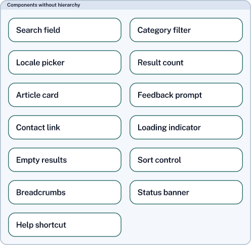
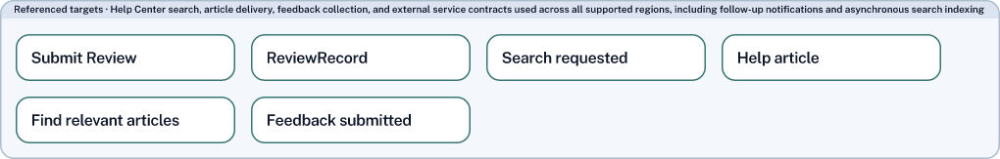

# UI Contracts horizontal packing proof

Production evidence for the corrected renderer-only spec and single local ticket
under `.scratch/ui-contracts-horizontal-layout/`.
The source is the durable [13-component fixture](../../../tests/fixtures/render/ui_contracts_horizontal.sdd),
derived from the existing dense/sparse renderer fixture. The accepted prototype remains
at `6c2245be0d847596ecc5b492ed66190e1bb5f737`; its temporary machinery is not used here.

Reproduce from the repository root:

```sh
TMPDIR=/tmp pnpm run build
TMPDIR=/tmp node scripts/render-ui-contracts-horizontal-proof.mjs
TMPDIR=/tmp pnpm exec vitest run tests/stagedUiContracts.spec.ts tests/stagedMacroLayout.spec.ts
```

The script uses the unchanged v0.2 bundle and normal compile/project/staged-render
interfaces. Compact and detailed cases retain ordinary scopes and normal visibility.
The wide-title case substitutes the target label on an in-memory view copy. PNGs are
derived from the same SVG; section images crop only the SVG viewport for inspection.
No scene geometry is edited after layout or routing.

| Case | Component rows | Component width | Target rows | Target width |
| --- | --- | --- | --- | --- |
| [Compact SVG](compact.svg) / [PNG](compact.png) | 2,2,2,2,2,2,1 | 496 | Hidden by normal detail policy | — |
| [Detailed SVG](detailed.svg) / [PNG](detailed.png) | 2,2,2,2,2,2,1 | 496 | 2,2,2 | 496 |
| [Wide-title SVG](wide-title.svg) / [PNG](wide-title.png) | 2,2,2,2,2,2,1 | 496 | 4,2 | 1019.945 |






Visual inspection matched the selected prototype: normal padding and gutters, top
alignment, contained titles, intact earlier rows above a ragged last row, and no
premature target wrapping. Both ordinary-title enclosures shrink from the detailed
packing budget of 611.748 to 496. Card positions, sizes, contents, ordering and row
membership, plus enclosure heights, compare exactly before/after fitting through the
shared pipeline. The wide title enlarges only its own section.

[evidence.json](evidence.json) records dimensions, card positions, rows and empty
diagnostic lists. The tests additionally cover mixed card heights, a two-card single
row, zero/one components, v0.1/v0.2, independent card/title minima in both directions,
components alone, both wrapping sections with no ordinary siblings, singleton width
suppliers, title-aware fallback, deterministic output, unchanged projection and
SVG/PNG bounds. Synthetic no-sibling scenes explicitly remove ordinary scopes only
inside the tests; production scope visibility is preserved.

The proof passed geometry acceptance before renderer snapshots were refreshed.
Bundle files, bundle code, bundle examples and bundle-owned snapshots are unchanged.

Verification on 2026-10-15: build passed; both focused renderer files passed all
60 tests; `TMPDIR=/tmp pnpm test` passed 2,021 tests across 182 files. Separate
standards and spec reviews reported no findings. The final source diff touches
only the scene builder, shared layout and renderer-internal layout intent.
